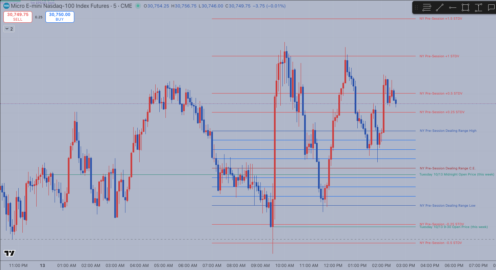
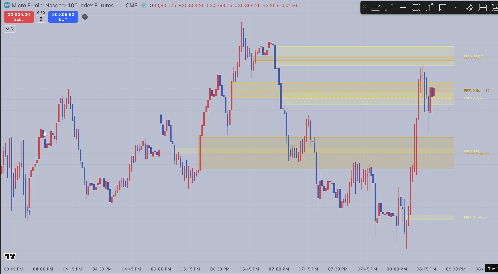

# TradingView Indicators

Custom TradingView indicators written in Pine Script (v5 and v6) for futures charting (MNQ / MES). They mark session-based price levels so I can study how price reacts around them.

## Indicators

| Indicator | What it does |
|---|---|
| [NY Pre-Session Dealing Range](ny-presession-dealing-range/) | Marks the 7–9am New York range with its midpoint, standard-deviation extensions, octant levels, and the 9:30 and midnight opens |
| [FPFVG / LPFVG Session Suite](fpfvg-lpfvg-session-suite/) | Marks the first and last fair value gaps in 13 New York sessions, five slots each, detected from true 1-minute data on any chart timeframe. 20 versions in the history. |

More indicators are being added.

## Built with Claude

I don't come from a programming background. I built these by working with Claude as a development partner:

1. **Describe it.** I explained what I wanted in trading terms and shared chart screenshots of how it should look.
2. **Build it.** Claude wrote the Pine Script.
3. **Test it.** I ran each version on live charts and reported what was off: a runtime error, a line ending at the wrong time, labels cluttering the chart.
4. **Iterate.** Claude revised it, and we repeated until it matched how I actually use it.

Each version is committed separately, so the commit history shows that loop step by step. Each indicator's README also lists the known limitations honestly, including what hasn't been tested yet.

## Install any indicator

1. In TradingView, open the **Pine Editor** at the bottom of a chart.
2. Paste in the indicator's `.pine` file and click **Add to chart**.

## Credits

The trading concepts (dealing ranges, standard-deviation projections, fair value gaps) come from ICT's public teaching. All code is original.

*For educational purposes only. Not financial advice.*
