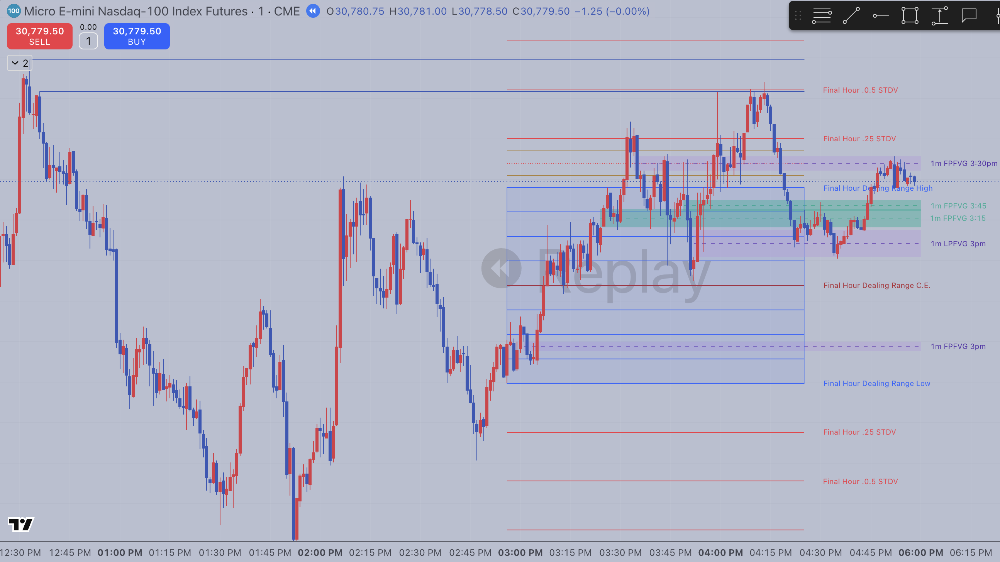

# ICT Final Hour Macro

A TradingView indicator (Pine Script v6) for MNQ / MES charts that maps out the last hour of the New York session. It marks the Final Hour Dealing Range, projects fib and standard-deviation levels from it, shows where price may reverse late in the hour, and marks the 1-minute fair value gaps that form between 3:00 and 4:00pm.

The goal behind it is ICT's Market-on-Close macro: a raid on stops resting inside the final hour range, confirmed by SMT divergence between NQ and ES, during the 3:50–4:00pm window. This version builds the foundation for that: the range, the levels and the gaps. Raids, SMT, targets and signals are later steps in the [project charter](PROJECT_CHARTER.md).

## What it draws

**Final Hour Dealing Range.** A shaded box with high and low lines covering the 2:55–3:30pm New York range. It starts a few minutes before 3:00 so a high or low printed just before the hour still counts.

**Fib levels inside the range.** The .125, .25, .375, .625, .75 and .875 levels in blue, plus the midpoint (C.E., 0.5) in dark red.

**Standard-deviation levels outside the range.** Permanent red lines at .25, .5, .75, 1, 1.5 and 2 STDV above and below. The 1 and 2 STDV lines are labeled, as is the STDV target cap (.5 by default).

**Hidden eighth and sixteenth levels.** Every other 1/16 step out to 2 STDV stays hidden until a 1-minute candle touches that exact price between 3:30 and 4:00pm. Eighths appear as dotted red lines and sixteenths as gold lines, so only the levels price actually reacts to show up.

**Possible Reversal Level and High/Low.** If price breaks the 1 STDV level on one side before 3:58pm, the indicator follows that side from 3:58 to 4:06pm and labels two levels:
- **Possible Reversal Level**: the eighth step nearest the farthest close
- **Possible Reversal High** (or **Low** on a bearish day): the eighth step nearest the farthest wick

Both only move farther out and never move back in. When one lands on a permanent line, that line is recolored and relabeled instead of a second line being drawn on top of it.

**1-minute fair value gaps from 3:00 to 4:00pm.** These are detected from true 1-minute data on any chart timeframe:

| Box | Rule |
|---|---|
| 1m FPFVG 3pm | The first gap after 3:00 |
| 1m FPFVG 3:15 | The largest gap whose middle candle is between 3:15 and 3:25 |
| 1m FPFVG 3:30pm | The largest gap whose middle candle is between 3:30 and 3:40 |
| 1m FPFVG 3:45 | The largest gap whose middle candle is between 3:45 and 3:50 |
| 1m LPFVG 3pm | The most recent gap whose middle candle is between 3:50 and 4:00 |

If the 3:45 gap and the last gap turn out to be the same one, only the LPFVG box is kept. Each box has a dashed midline and extends until 11pm New York time.

**History.** The last 20 trading days stay on the chart for backtesting. Range, fib and STDV lines keep projecting 10 bars ahead of price until 4:25pm, then freeze.

## Inputs

| Setting | Default |
|---|---|
| Final Hour Dealing Range (NY time) | 1455–1530 |
| Stop extending lines at (NY time) | 1625–1630 |
| Bars to project lines ahead of current price | 10 |
| Show Fib / STDV Levels | On |
| STDV Target Cap | 0.5 |
| Number of trading days to keep on chart | 20 (max 20) |
| Show dynamic eighth/sixteenth levels | On |
| Dynamic level trigger window (NY time) | 1530–1600 |
| Exact-touch tolerance (ticks) | 1 |
| Show Possible Reversal Level/High | On |
| Reversal evaluation window (NY time) | 1558–1606 |
| Show 1m Fair Value Gaps | On |
| Restrict indicator to a single test date | Off (test date 2026-08-03) |

## How it was built

The first attempt put everything in one script: range, fibs, equal highs and lows, raids, SMT and targets. That was too much to test at once. So I wrote a [project charter](PROJECT_CHARTER.md) with Claude and restarted with one capability per iteration. Each iteration had to compile and match a TradingView Replay of August 3, 2026 before the next one began.

The commit history keeps the versions that survived:

1. **Monolithic first draft**, with every feature in one script
2. **Iteration 1**, the dealing range box only, alongside the charter
3. **Iteration 2 snapshot**: fib quadrants, C.E., STDV lines and the touch-triggered ladder
4. **Experiment**: equal highs and lows (buyside/sellside liquidity) built on that snapshot, kept in [`experiments/`](experiments/) and not carried forward
5. **Latest version**: look-ahead projection, 1/1.5/2 STDV, reversal levels, the 1-minute FVG trackers and a sturdier freeze

Many working versions in between weren't saved, so the history jumps between these snapshots rather than showing every step.

## Known limitations

- **Two fixes haven't been confirmed on a live chart yet.** One makes lines freeze correctly over weekends and on 15-minute or higher charts. The other is the bearish-day path of the reversal levels.
- SMT divergence, raid detection, targets and signals from the charter aren't in the latest version. Early forms of them exist only in the first draft.
- Equal highs and lows exist only in the experiment file.
- On days when many hidden levels trigger, 20 days of history can approach TradingView's 500-line limit and the oldest lines may disappear. Lowering the history days fixes this.
- The indicator's title in TradingView still reads "Iter 2", and a code comment says the FVG boxes stop at 8pm when they actually stop at 11pm.
- Built for MNQ / MES on New York time. Other markets haven't been tested.

## Install

1. In TradingView, open the **Pine Editor** at the bottom of a chart.
2. Paste in [`ict_final_hour_macro.pine`](ict_final_hour_macro.pine) and click **Add to chart**.

*For educational purposes only. Not financial advice.*
